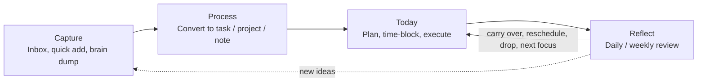
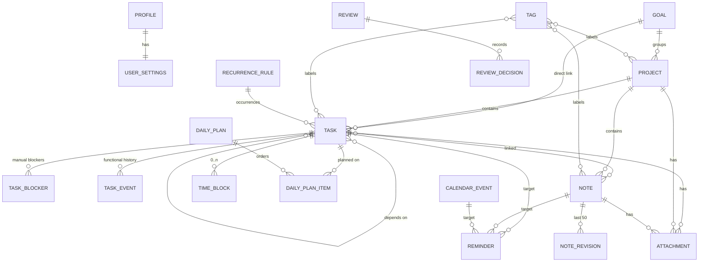
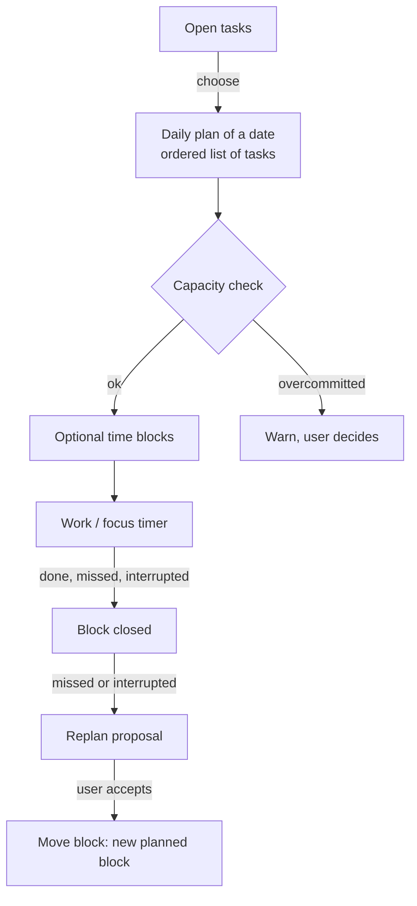
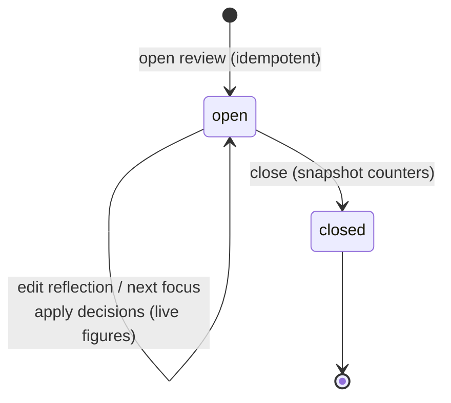
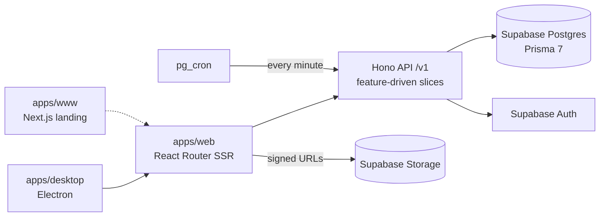

# useGonche

**useGonche** is a personal productivity app for a **single user**. It turns messy work into concrete, executable progress and helps decide _what to do, when and how_.

It is not a Notion/Todoist/Sunsama clone, not enterprise software, not collaborative and not multi-tenant.

This document describes the **business logic** behind every feature: what each entity means, which rules the system enforces, and what is deliberately out of scope.

## Principles

- **Manual-first.** Everything works without AI or automation. Nothing is mandatory: the user can enter the cycle at any stage and work manually at any time.
- **Concepts are separated by lifecycle.** Task status, priority, scheduling, progress, blocking and history are different things and are never mixed into one field (see [Task](#task)).
- **Derived data is computed, not stored.** Progress, "blocked", capacity, review figures and metrics are computed on read. The only snapshot is a closed review.
- **Explainable, not opaque.** Every figure is a plain sum or count. There are no scores.
- **Replanning never rewrites history.** Moving a time block creates a new block; changing a task writes a history event.
- **Nothing is lost while classifying.** Inbox items are never deleted, and goals and projects are archived, never deleted.
- **Single user now, evolvable later.** Every resource carries an explicit `owner_id` and every query is owner-scoped, but there are no workspaces, roles or sharing.
- **User time zone everywhere.** "Today", week boundaries, streaks and all day-level figures use the time zone saved in the user's settings.

## The Flow Cycle

The product methodology is a loop with four visible stages. Reflect feeds the next Plan. Clarify and Prioritize are internal: they run as suggestions inside Process, never as modules. The methodology is provisional and open to revision.

| Stage       | App area                         | What happens                                                                                             |
| ----------- | -------------------------------- | -------------------------------------------------------------------------------------------------------- |
| **Capture** | Inbox                            | Fast entry of anything, with no organizing required.                                                     |
| **Process** | Inbox → Tasks / Projects / Notes | Empty the inbox: convert, archive or discard each item. Priority is a simple level the user sets.        |
| **Today**   | Today, Calendar, Tasks           | Pick the day's tasks against real capacity, optionally time-block them, work, log progress and blockers. |
| **Reflect** | Reflect, Analytics               | Review what was planned vs. executed and decide what happens to what is left.                            |

## Domain model

Every entity above (except join tables) has an `owner_id` referencing the profile.

## Features

### 1. Accounts, onboarding and settings

- **Sign in:** email + password (with email verification, forgot/reset password) and Google (web popup code flow; the desktop app uses a loopback redirect with PKCE). Authentication is delegated to Supabase Auth. The API accepts a session cookie or a `Authorization: Bearer` token.
- **Profile sync:** the app profile (`id` mirrors the Supabase user id) is created by a database trigger on sign-up and re-synced idempotently after every sign-in. The display name comes from sign-up or from Google. The user id always comes from the verified token claims, never from a request body.
- **Profile fields:** display name, avatar, phone, website, bio, job title, industry, company. The avatar is uploaded straight to the public bucket (JPEG, PNG or WebP) under a fresh name each time, so a new picture never serves a stale cache.
- **Settings (1:1 with the profile):** language, theme, country, IANA time zone. Defaults are `language: system`, `theme: system`, `timezone: UTC`.
- **Mandatory onboarding:** the user must set theme, language, country and time zone. It is marked complete only when all four are present, otherwise it is rejected with `onboarding_incomplete`.
- **Availability** (working hours) is configured in Settings; see [Availability](#availability-and-calendar-events).
- **Shortcuts:** a read-only list of every registered shortcut.

### 2. Capture: Inbox

The inbox holds raw captures. It is the only entry point that requires no decisions.

- **Quick capture:** one line of text → one item with source `quick`.
- **Brain dump:** a block of text, one item per line → many items in a single write with source `braindump`.
- **Statuses:** `pending` → `converted` | `archived` | `discarded`.
  - `converted` is **terminal** and only happens by creating a task, project or note from the item. The target stores `origin_inbox_item_id`, which is unique, so an item converts **at most once**. Conversion happens in the **same transaction** that creates the target, so the item is never lost.
  - `archived` / `discarded` can be restored to `pending`. `processedAt` is set when the item leaves `pending` and cleared on restore. Setting the current status again is a no-op.
  - Items are **never deleted**.
- **Listing:** filter by status tab and by a rolling range (`24h`, `7d`, `30d`, `all`). Each tab shows its counter within the same range. Paginated, newest first.
- A converted task gets origin `inbox` (manual tasks get `manual`).

### 3. Organize: Goals, Projects, Tasks

#### Goals

An outcome the user wants to reach. A goal groups projects (1:N) and can also link tasks directly.

- Fields: title, Markdown description, optional target date.
- **Status** `active` | `achieved`. **Archiving** is separate (`archivedAt`), so an achieved goal can be archived and an archived one restored. Archiving is idempotent and keeps the original timestamp. Its projects are untouched. Goals are **never deleted**.
- **Progress** is derived: done / counting tasks. A task counts if it is linked to the goal directly, or belongs to one of the goal's projects **without a goal of its own** (so no task is counted twice). Cancelled tasks do not count.
- List tabs: one counter per status plus archived. The due filter (overdue / due soon) only applies to **active** goals. Goals without a target date sort last when sorting by it.

#### Projects

A container of tasks, optionally under a goal.

- Fields: title, Markdown description, optional goal, tags, attachments, notes.
- **Status** `active` | `on_hold` | `completed`. Archiving is separate and keeps all its tasks. Projects are **never deleted**.
- **Progress** is derived the same way (cancelled tasks excluded).
- Can be created from an inbox item (see [Inbox](#2-capture-inbox)).
- List tabs: counters per status plus archived, following the goal and tag filters but not the status.

#### Task

The unit of work. The model keeps these concerns **independent**:

| Concept    | Where it lives                                | Notes                                                                         |
| ---------- | --------------------------------------------- | ----------------------------------------------------------------------------- |
| Status     | `todo` → `in_progress` → `done` / `cancelled` | `completedAt` is set on `done`, and cleared on reopen or `cancelled`.         |
| Priority   | `low`, `medium` (default), `high`, `urgent`   | A simple level; no scoring.                                                   |
| Deadlines  | `startDate`, `dueDate` (date-only)            | The user's own dates. `dueDate` must not be before `startDate`. Not planning. |
| Estimate   | `estimatedMinutes` (1–100,000)                | Used for capacity.                                                            |
| Scheduling | Daily plan and time blocks                    | A task has no "scheduled for" field; see [Today](#4-today-plan-and-execute).  |
| Progress   | Derived from subtasks                         | Cancelled subtasks are not counted.                                           |
| Blocking   | Derived from blockers + dependencies          | Informational; never prevents any action.                                     |
| History    | `task_events`                                 | Typed, written in the same transaction as the change.                         |

Other task rules:

- **Subtasks** are a **single level**: the parent must exist, be the owner's and be top-level. A task with subtasks cannot become a subtask, and a task cannot be its own parent. Deleting a task deletes its subtasks.
- **Tags**, a Markdown description, a project, a goal, attachments and linked notes.
- **Dependencies:** a task can wait for other tasks. No self-dependency (422) and **no cycles** (409, detected by walking the dependency graph). Adding an existing dependency is a no-op.
- **Blockers:** a manual impediment with a reason (≤ 500 chars). Resolving sets `resolvedAt` (409 if already resolved). Resolved blockers are **kept** so recurring blockers can be analyzed.
- **Blocked** (derived) = has an open blocker **or** a dependency that is not `done`/`cancelled`.
- **Idempotent updates:** only fields that really change are written (tags are compared as a set). An update that changes nothing writes nothing: no `updatedAt` bump, no history event.
- **Functional history** (`TaskEvent`): `status_changed`, `priority_changed`, `due_changed`, `project_changed`, `rescheduled`. Each event has typed `from`/`to` columns and an `actor` (only `user` is written today; `system`, `ai`, `integration` are reserved). This is not an enterprise audit log.
- **Bulk update:** up to 50 tasks in one transaction, each through the normal update rules (completion, history, recurrence, date order). Every id must be the owner's or nothing is written. `shiftDays` (±3650) moves start and due dates.
- **Listing:** server-side filters by status (multi), priority, project / no project, goal, tag, due range / no due date, blocked, recurrence, title text; sort by several fields (null dates last); optional grouping with groups sized over the whole filtered set. Counters per status plus `blocked` and `overdue` follow every filter but the status. A **focus** filter returns the working set: open tasks that are overdue, due within the week or undated, plus tasks closed in the last 7 days.
- **Deleting** a task cascades to its subtasks, dependencies, blockers, tag/note links and attachment rows, and removes the attachment files from Storage.
- **Quick add (frontend):** a line such as `Review contract #legal !high tomorrow ~1h` is parsed on the client, without AI: `#project`, `!priority`, `~estimate` (`~30m`, `~1h`, `~1h30`) and a date (`today`, `tomorrow`, weekdays, `in 3 days`, `2026-12-31`, `24/12`, in English and Spanish). A date word is only read at the end of the line. "Today" is the user's calendar day, not the browser's clock.
- **Views:** list and board, filter bar, status tabs and a detail drawer (properties, description, subtasks, dependencies, blockers, history, attachments, notes).

### 4. Today: plan and execute

#### Availability and calendar events

- **Availability:** a weekly template of working-hour windows. One row per window; a weekday can have several. `weekday` is ISO (1 = Monday … 7 = Sunday), minutes are the local wall-clock minutes of the day in the user's time zone (0–1440), up to 70 windows. Saving replaces the whole template; saving the same template changes nothing.
- **Calendar events:** manually entered (external calendars are future work). Stored as an instant range; **all-day** events cover the user's local day(s) at creation time.
  - Kind `event` or `out_of_office`.
  - `out_of_office` removes availability. A **timed** `event` does too. An **all-day** `event` is informational only.

#### Daily plan

- A plan is the **ordered list of tasks chosen for one local date**, created lazily when the first task is planned. One plan per date.
- Setting the day's tasks replaces the list in order. Tasks must be the owner's, and tasks being **added** must be open. A task already in the plan stays even if it has since been finished, so the day keeps its history.
- A plan is independent of the task's `dueDate`; planning never edits the task.

#### Capacity

The day view returns plain sums, not scores:

| Figure             | Definition                                                            |
| ------------------ | --------------------------------------------------------------------- |
| `workingMinutes`   | Availability windows of that weekday.                                 |
| `availableMinutes` | Working minutes minus out-of-office and timed events.                 |
| `plannedMinutes`   | Sum of estimates of the plan's **open** tasks.                        |
| `unestimatedTasks` | Open planned tasks with no estimate (they add 0 to `plannedMinutes`). |
| `scheduledMinutes` | Minutes already covered by planned time blocks within the day.        |
| `remainingMinutes` | `availableMinutes − plannedMinutes` (negative when overcommitted).    |
| `overcommitted`    | `plannedMinutes > availableMinutes`.                                  |

#### Time blocks

A **time block** is a slice of time, not a task. A task can have **zero or many** blocks, and a block can have no task (then a title is required).

- Status: `planned` → `done` | `missed` | `interrupted` | `rescheduled`.
- Each block has a planned range and optional actual start/end. The end must be after the start.
- **Conflicts are warnings, never errors:** `overlaps_block`, `overlaps_event`, `outside_availability`. The user decides.
- A block can only be planned for an existing **open** task.
- **Closing a block:** `done` (actual times default to the planned ones), `missed` (no actual times allowed), or `interrupted` (needs both actual times). Closing a block **never** changes the task: finishing a block is not finishing the task. Actual times of a closed block can be edited later.
- **Moving a block never edits it.** It creates a new `planned` block linked through `rescheduledFromId`. A `planned` original becomes `rescheduled`; a `missed` or `interrupted` one keeps its status (what happened stays on record). A block can be moved **once**; move the new one to move again. Moving a task's block writes a `rescheduled` history event.
- **Deleting** is allowed only for blocks still `planned` that were never moved; the rest is history.
- **Replan proposals:** for each `missed`/`interrupted` block of a day that has not been moved, the API proposes the **first free slot** (working hours minus busy events and planned blocks, never in the past, within a 1–14-day window) that fits what is left to do (planned minus actually worked). Proposals are **never applied automatically**; the user accepts one by moving the block. Blocks of done/cancelled tasks are skipped, and a proposal can have no slot.

#### Today screen

Plan card (ordered tasks with drag and drop), capacity card, agenda (hour grid: click an empty slot to plan a block, click to edit, drag to move), events, replan proposals, blocked tasks (informational), quick focus, inbox summary and recent activity (global task-event feed).

#### Focus timer

A client-side timer (presets 15 / 25 / 45 / 60 minutes, optionally tied to a task). Pausing does not count as worked time. Finishing records a time block as `done`, stopping early records it as `interrupted`, both with the time really worked. Sessions shorter than **1 minute are not recorded**. The session lives in memory and survives page navigation; nothing is stored until it ends.

#### Calendar

A calendar page to view and manage events, all-day events and time blocks across days.

### 5. Recurrences

Repeat a task on a calendar-day schedule.

- A rule is an **RFC 5545 RRULE** (without DTSTART; `startDate` is the DTSTART), expanded by the `rrule` library, plus a **task template** (title, description, priority, estimate, project, goal, tags).
- **Each occurrence is a normal task** with its own status and history, unique per `(rule, occurrenceDate)`. Occurrences stay date-only.
- **Optional time of day:** `startMinute` + `durationMinutes` (both or none) also create a **planned time block** on each occurrence at that local wall-clock time ("every day at 9 am").
- **Generation window:** 14 days ahead of the user's today. `materialize` is **idempotent** and generates only from the last examined day (`generatedUntil`), so an occurrence the user deleted is **never re-created**. Something must call it periodically; the client calls it when opening Today.
- **Completing or cancelling** an occurrence makes sure the next one exists, even beyond the window (monthly/yearly rules). Nothing happens if it already exists or the rule has ended.
- **Edit = "this and following":** only **future untouched** occurrences change. A new rule, start date or time regenerates them from today; template edits are copied onto them. Past, started and finished tasks never change.
- **Untouched** future occurrence = `todo`, today or later, no attachments, and no time block that was started, finished or moved.
- **Delete** removes the rule and its future untouched occurrences. Past, started and finished tasks stay and only lose the link.

### 6. Notes

A free-form document. There is one note entity (no separate "document").

- Fields: title, Markdown body, optional project, tags, linked tasks, attachments.
- **Rich text** is edited with TipTap on the client, converted to **Markdown on the client** and stored as plain `text`. The API only bounds the size (100,000 characters).
- **Lists omit the body** and carry a 200-character plain-text excerpt; fetch the note to read the body.
- **Revision history:** every change of title or body first saves the previous version as a revision, in the same transaction. Only the latest **50** per note are kept. Revisions are immutable. **Restoring** one is a normal edit, so what it replaces becomes a new revision; restoring the current version changes nothing.
- A note is created from an inbox item the same way as a task or project.
- **Deleting** a note cascades to tag/task links, revisions and attachment rows, and removes the attachment files from Storage.

### 7. Tags

- Owner-scoped labels with an optional `#rrggbb` color. Names are unique per owner, **ignoring case** (`409 already_exists`).
- A tag can label **tasks, projects, notes and recurrence rules** through typed join tables.
- The list shows, for each tag, how many tasks, projects and notes carry it, with a name search (case-insensitive, anywhere in the name).
- **Deleting a tag** removes only its links, never the tagged items.

### 8. Attachments

Files are attached to **exactly one** of task, project or note.

- **The file bytes never go through the API or the database.** The flow has three steps: (1) the API returns a signed upload URL, (2) the client uploads straight to Supabase Storage, (3) the client records the metadata; the API verifies the path belongs to the owner and the file exists.
- Private bucket, path `<ownerId>/<uuid>/file`, original name kept in the database. Maximum **50 MB** per file.
- Downloads use a **short-lived signed URL** (1 hour).
- Deleting an attachment, or a parent, removes the Storage files on a best-effort basis: the database is the source of truth, so a failure leaves an orphan file, never a dangling row.

### 9. Reminders

A reminder fires at a time and targets **exactly one** task, calendar event or note.

- **Independent of deadlines:** it never reads or changes a task's due date.
- Status: `pending` → `sent` | `dismissed`.
- A scheduled job (`pg_cron`, every minute) calls an internal endpoint protected by a secret header. It claims due reminders with a **conditional update** `pending → sent`, so overlapping runs or retries never deliver twice. It handles up to 100 per run; a backlog drains over later runs.
- **Internal only:** reminders appear in the web app's Reminders page. There is no email or push delivery.
- **Edit** only while `pending` (409 otherwise, including when the processor claims it in between). **Snooze** moves `remindAt` forward and returns a `pending` or `sent` reminder to `pending` (a dismissed one stays dismissed) and counts snoozes. **Dismiss** is idempotent.
- Deleting the target deletes its reminders.

### 10. Reflect: reviews

A **daily** or **weekly** reflection (a weekly period is Monday–Sunday of the week containing the given date). One review per `(kind, period)`.

- **Open** is idempotent: opening an existing period returns it (200) instead of duplicating (201 on creation).
- **While open**, the figures are **computed live** from real data and nothing is stored (`prefill`):
  - tasks **planned** in the period's daily plans and tasks **completed** in it;
  - **pending** = planned tasks still open (the carry-over candidates);
  - minutes **planned** vs. **actually worked** in time blocks, and the number of **missed** blocks;
  - **priority and due-date changes** made in the period;
  - **recurring blockers**: reasons (grouped ignoring case and spaces) seen at least twice in the period plus the 90 days before it, and at least once during the period.
- **Decisions** on pending tasks, applied in one transaction (all or none), once per task per review (409 afterwards, since effects cannot be undone):
  - `carry_over`: plan it for a target date;
  - `reschedule`: move its due date to the target date (writes a `due_changed` event, and must not precede `startDate`);
  - `drop`: cancel it (writes a `status_changed` event);
  - `keep`: change nothing.
    Only open tasks can be decided on.
- **Reflection** and **next focus** are plain text, editable only while the review is open.
- **Close** snapshots four counters (planned tasks, completed tasks, planned minutes, actual minutes) so the review keeps its meaning even if tasks change later. Pending tasks do **not** need a decision to close. A closed review cannot be edited (409).
- A review must produce **decisions, not reports to maintain**.

### 11. Analytics

Read-only dashboards, all computed on read in the user's time zone, for a date range, optionally narrowed by project, goal, tag or priority. Each aggregate reads at most 5,000 rows.

| Metric           | What it shows                                                                                                                                                                                                                                                                                                                                                                                                                                                                                                                                   |
| ---------------- | ----------------------------------------------------------------------------------------------------------------------------------------------------------------------------------------------------------------------------------------------------------------------------------------------------------------------------------------------------------------------------------------------------------------------------------------------------------------------------------------------------------------------------------------------- |
| **Summary**      | Per period and previous period of the same length: tasks created/completed, focus minutes, planned minutes, on-time ratio (completed on or before due date), plan completion ratio (planned tasks now done), reschedules (due-date changes + moved blocks), estimate accuracy (estimated vs. real time of completed tasks that had an estimate and finished blocks). Plus a snapshot: open, blocked and overdue tasks, and the current and longest completion **streak** (consecutive local days with a completed task, looking back one year). |
| **Throughput**   | Tasks created vs. completed per day or week (every bucket present, with zeros).                                                                                                                                                                                                                                                                                                                                                                                                                                                                 |
| **Focus time**   | Planned vs. actually worked minutes per day, and how many blocks ended `done` / `missed` / `interrupted`. Moved blocks are not counted twice.                                                                                                                                                                                                                                                                                                                                                                                                   |
| **Planning**     | For each daily plan, how many of its tasks are done now, and the overall rate.                                                                                                                                                                                                                                                                                                                                                                                                                                                                  |
| **Distribution** | Tasks per project (open and completed), per priority, and per status.                                                                                                                                                                                                                                                                                                                                                                                                                                                                           |
| **Blockers**     | Blockers started in the period grouped by reason, with open/resolved counts and average hours to resolve.                                                                                                                                                                                                                                                                                                                                                                                                                                       |
| **Rhythm**       | Completed tasks by hour of day and by weekday, with the peak hour and weekday.                                                                                                                                                                                                                                                                                                                                                                                                                                                                  |

### 12. Task history and activity

- **Per task:** the task drawer shows its functional history (newest first, paginated).
- **Global feed:** a recent-activity feed across all of the user's tasks, with the task title included.
- History is written by the services in the same transaction as the change, so it never disagrees with the data.

### 13. Navigation and productivity UX

- Sidebar by Flow Cycle stage; the command palette opens with ⌘K / Ctrl+K and `g` + a letter jumps to a section.
- URL-synced filters and pages (page number lives in the URL).
- Bulk selection bars for tasks and inbox items.
- The UI is localized from stable API error codes; the API itself returns English fallback messages.

## Development commands

All commands are available as `make` targets (`make help` lists them): `api-*`, `web-*`, `desktop-*`, `www-*`, `db-*`, plus `lint`, `format`, `typecheck`, `test` and `check`. See [`CONTRIBUTING.md`](CONTRIBUTING.md) for the contribution workflow and [`MANUAL.md`](MANUAL.md) for backend setup and deploy.

## API conventions

- All endpoints live under `/v1` (except `GET /health`).
- Responses: `{ data, meta? }` on success; `{ error: { code, message, details?, requestId? } }` on failure. Clients localize by `code`.
- Every list is **offset-paginated** (`page`, `pageSize` ≤ 100) with `{ page, pageSize, total, pageCount }`.
- Inputs are validated with Zod (`422 validation_error` with per-field `details`); unknown keys are rejected on writes.
- Every protected route requires auth, and every query is scoped by owner.
- Errors: `404 not_found`, `409 invalid_state` (wrong state), `409 already_exists`, `409 dependency_cycle`, `422 validation_error`.

## Limitations and out of scope (current)

- **Single user.** No workspaces, organizations, memberships, invitations, roles/permissions, comments or sharing.
- **No AI, agents, automations, custom workflows or planning rules.** The `ai` / `system` / `integration` actors in history exist only as reserved values.
- **No third-party integrations** (GitHub, Google Calendar/Drive, Notion, Gmail, Slack, Meet/Zoom). Calendar events are entered manually. When integrations arrive, external items will _not_ be tasks until the user converts them, and the core domain will stay independent of provider types.
- **Reminders are internal only**: no email or push delivery.
- **Recurrences are day-level**: tasks stay date-only, only future untouched occurrences are edited, and something must call `materialize` periodically (the client on opening Today, and a scheduled job later).
- **Subtasks are one level deep.**
- **Blocking is informational.** A blocked task or an unmet dependency never prevents any action.
- **Time-block conflicts are warnings**, not constraints.
- **A time block can be moved only once** (move the new block to move again), and only `planned` blocks can be deleted.
- **A review decision cannot be undone** and applies once per task per review.
- **Note history is capped at 50 revisions** per note; older ones are dropped.
- **Attachments:** 50 MB each, one parent only, private bucket.
- **Metrics read at most 5,000 rows** per aggregate; there is no productivity scoring.
- **Goals and projects cannot be deleted**, only archived. Inbox items are never deleted.
- **Rich text is Markdown** (no JSON documents), bounded to 100,000 characters.
- **The functional history is not an audit log.**

## Architecture and tech stack

- **API:** Hono (Node and Cloudflare Workers entries), Zod 4, Prisma 7 with the pg adapter, `rrule`, rate limiting. One vertical slice per feature (`routes` / `schemas` / `service`), typed RPC client shared with the apps.
- **Data:** Supabase Postgres (Prisma manages only the `public` schema), Supabase Auth, Supabase Storage. UUID v4 ids, `timestamptz` timestamps, no JSON columns, typed history tables.
- **Web:** React Router (SSR), react-query as the client cache, TipTap, nuqs for URL state.
- **Desktop:** Electron app that loads the web app, with native Google sign-in.
- **Landing:** Next.js (`apps/www`).
- **Tooling:** pnpm workspaces, TypeScript, Biome, Vitest (every service and endpoint is tested).
